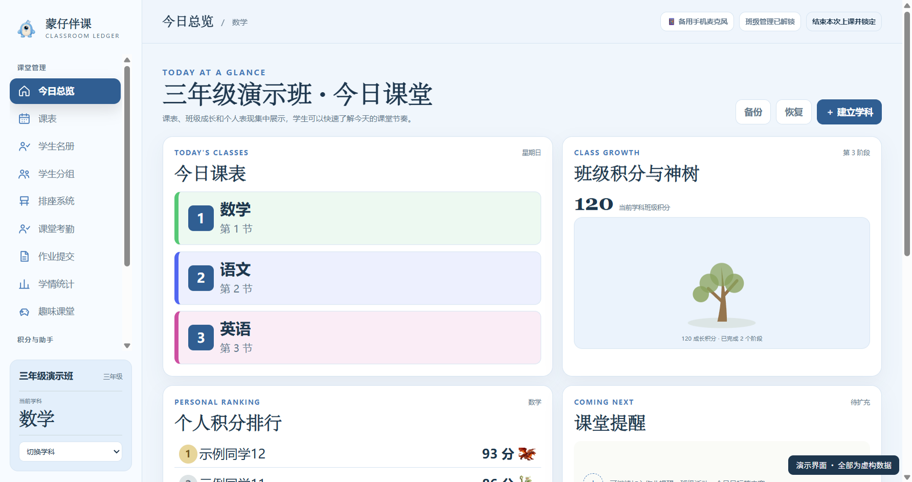
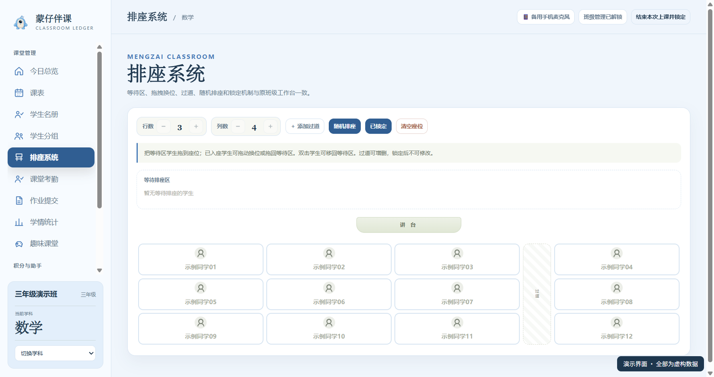
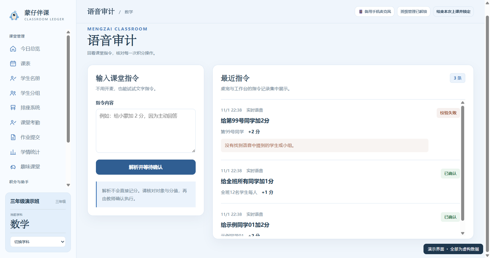

# 蒙仔伴课

**会陪伴、能对话，还能把课堂指令接到真实工作台的蓝色桌宠。**

面向教师的 Windows 单班级课堂工具，适合教室电脑和希沃大屏。教师通过班级工作台管理日常事务，也可让蓝色蒙仔辅助查询、记分和基础互动。

## 下载

**[下载蒙仔伴课 1.4.2 · Windows x64 便携 EXE](https://github.com/SevenDamon/Mengzaibanke-Releases/releases/download/v1.4.2/Mengzaibanke-1.4.2.exe)** · [版本说明与校验文件](https://github.com/SevenDamon/Mengzaibanke-Releases/releases/tag/v1.4.2)

- 版本性质：公开测试版本。文件大小约 231.65 MiB。
- 本仓库只用于软件分发、功能介绍和使用说明，不公开应用开发源码，也不是开源项目。
- 下载后放到便于保存的位置，双击 EXE 启动；首次启动创建班级并妥善保存恢复码。
- 已有用户升级前先备份班级数据。1.4.2 沿用现有用户目录，无须重新创建班级或重填模型配置。

## 能做什么

### 特色一：桌面上随时可唤起的蒙仔

蒙仔作为独立桌宠陪在教学桌面上，可拖动、调整大小，拖到屏幕下边缘可趴边陪伴；倾听、处理和奖励时切换对应形象。老师讲课、展示课件时，可以继续使用自己的教学软件，需要时再唤起蒙仔。

电脑保留右键菜单，教学大屏支持长按呼出菜单；可以打开工作台、设置、调整大小或隐藏桌宠。它既是课堂伙伴，也是工作台的语音操作入口。

### 特色二：说完一句话，接着聊下去

配置语音服务后，说“蒙仔蒙仔”即可唤醒。老师与学生可以和它聊天、听故事、讲笑话、玩脑筋急转弯；表达方式参考当前班级的年级，陪伴互动不等于正式测评。

- 可选实时语音，识别与对话衔接；嘈杂环境可手动点“发送”。实际延迟受设备、网络和服务状态影响。
- 可随时停止回答或结束对话，方便教师收回课堂节奏。
- 自动达到轮数或时限后暂停；十分钟内重新唤醒可接续近期普通聊天或有效谜语。主动结束等会清空，不是永久记忆。

### 特色三：语音不是只会聊天，还能联动班级数据

例如说：

> “蒙仔蒙仔，给第1号同学加2分。”  
> “给全班所有同学加1分。”  
> “撤销上一笔。”

蒙仔识别操作，程序核对当前学科、学生或人数和分值，经教师确认后才写入工作台账本。**桌宠与工作台使用同一份班级数据**：记分成功后，积分与幻宠成长按实际数据刷新，并保留审计与撤销路径；不会只在对话里口头“加分成功”。

也支持按现有权限查询学生积分、幻宠成长和部分课堂资料；范围不明时需澄清，不能让模型编造余额。全班“每人加分”写入每位学生的个人流水，不等同于增加独立的班级总积分。

教师仍需掌握解锁、确认和设备控制。蒙仔不能仅凭声音判定说话人是否为教师；语音能力也需要提前配置相应第三方服务。

### 工作台基础能力

| 课堂需要 | 软件能力 |
| --- | --- |
| 组织班级 | 学生名册、学生分组、座位安排与课表；共享班级基础资料 |
| 记录课堂表现 | 分学科积分、考勤、作业提交、积分规则与流水；班级积分和个人积分独立 |
| 减少记分操作 | 语音给个人、小组或全班每位学生记分；须经教师确认，可撤销并查看审计记录 |
| 展示成长 | 幻宠乐园、成长图鉴与班级神树，让积分变化可视化；默认个人成长汇总已启用学科的正向积分 |
| 进行轻松互动 | 聊天、故事、笑话、脑筋急转弯；依据当前班级年级调整表达 |
| 控制课堂对话 | 手动发送、停止回答、结束对话；可选实时语音，自动暂停后十分钟内短期续接 |
| 在大屏操作 | 保留鼠标右键，支持长按呼出菜单；晴空蓝和米绿两种主题 |
| 保存班级数据 | 本机保存，工作台支持班级备份和恢复；教师控制管理与学科权限 |

## 界面预览

以下截图来自 **1.4.2 成品资源**，使用独立的虚构演示班级，均为示例数据，不代表真实学生或教学效果。

### 今日总览

集中查看课表、班级成长与个人表现，教师可从这里备份班级。

### 排座系统

直观安排学生座位，与名册和小组资料衔接。

### 幻宠乐园

展示学生幻宠与成长状态，领养及奖励操作由教师掌握。

### 语音审计

记录指令及确认状态，帮助教师核对每次积分操作。

## 第一次使用

1. 下载 EXE 并启动，创建班级，保存班级管理员恢复码。
2. 添加或导入学生名单，创建学科，设置对应学科的 PIN。
3. 先体验工作台手动管理和记分；使用语音前，再打开“设置 → 大模型服务 / 课堂语音”，按所选模式配置并测试。
4. 进入学科后可说“蒙仔蒙仔，给第 1 号同学加 2 分”；核对对象和分值后确认。全班操作须确认人数和每人分值。
5. 定期通过“工作台 → 今日总览 → 解锁班级管理 → 备份”保存班级备份。

## 配置、费用与隐私

- **工作台基础管理不要求先开通 AI 服务。** 模型与语音等第三方服务需自行配置和开通，相关用量与费用以服务商规则及账户账单为准。
- 实时语音默认关闭，启用前需开通对应实时服务；原语音模式、复杂指令解析及手机原语音链路仍涉及独立文字模型配置。具体开通步骤见软件内配置向导。
- 联网功能可能处理相关文本、音频及必要的班级数据。不要说出密码、住址等隐私，妥善保管服务凭证；仅将必要信息用于课堂操作。
- 班级数据保存在本机，需自行定期备份。PIN 用于防止界面误操作，不等于数据库文件加密；恢复码不能代替班级数据备份。
- 查看完整边界：[使用说明](USAGE.md)、[版权与服务边界](COPYRIGHT.md)、[第三方许可](THIRD_PARTY_NOTICES.md)。

## 问题反馈

遇到桌宠、语音、工作台联动或其他问题，可直接填写 **[问题反馈表单](https://mqhunwolc43.feishu.cn/share/base/shrcn79EcXJxhFLlgyTImXk2JTb)**，具体填写建议见 [反馈说明](FEEDBACK.md)。反馈会进入专用飞书多维表格，答卷不对外公开。

请写明版本、操作步骤与实际结果，附件和联系方式可不填；上传前遮挡学生信息、密钥和恢复码。当前1.4.2可先通过网页反馈，设置内入口尚未打入公开安装包。

## 1.4.2 的限制

- 面向单班级课堂，不提供多学校、多机构或多班级云管理。
- 实时语音为可选试验；受轮数、三分钟和无交互时限约束。自动暂停后的近期聊天与谜语状态仅在内存短期保留，主动结束、换课堂范围或退出等会清空。
- 当前不提供教材知识库、学科出题或正式判分。娱乐生成内容可能有误，需教师判断。
- 软件不能仅凭声音识别教师身份，请由教师掌握解锁后的课堂操作；伦理规则不保证识别所有风险。
- **本次分发的是原有 1.4.2 EXE，字节未改。** 2026-11-01 后调整的版权正文及新增说明入口尚未打入此文件；仓库中的当前版权与服务说明见 [COPYRIGHT.md](COPYRIGHT.md)。

© 2026 郑州市爱蒙斯教育科技有限责任公司。产品开发：躬行者。
